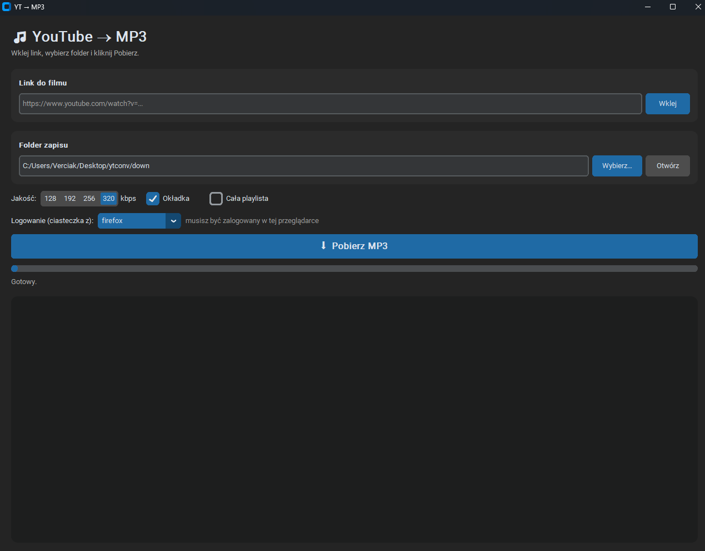

# 🎵 YT → MP3 Converter

Desktopowa aplikacja z nowoczesnym, ciemnym GUI do konwersji filmów z **YouTube** i **YouTube Music** na pliki **MP3**.  
Wklejasz link, wybierasz folder, klikasz **Pobierz** i gotowe.



## ✨ Funkcje

- 🎧 Konwersja do MP3 w jakości **128 / 192 / 256 / 320 kbps**
- 🖼️ Osadzanie **okładki** i **metadanych** (tytuł, wykonawca) w pliku
- 📂 Zapis do **wybranego folderu** i szybkie otwieranie go z poziomu aplikacji
- 📃 Pobieranie **całych playlist i albumów**
- 📊 Pasek postępu z procentami i prędkością pobierania na żywo
- 🔐 Obsługa filmów z ograniczeniem wiekowym (ciasteczka z przeglądarki lub plik `cookies.txt`)
- 💾 Zapamiętywanie ustawień między uruchomieniami
- ⚡ Pobieranie w osobnym wątku, więc interfejs nigdy się nie zawiesza
- 🧭 Czytelne komunikaty błędów z podpowiedziami

## 🛠️ Technologie

Python 3 · CustomTkinter · yt-dlp · FFmpeg · threading

## 🚀 Instalacja

**1. Zależności Pythona**

```bash
pip install -r requirements.txt
```

Na Windowsie, jeśli `pip` nie jest rozpoznawany:

```bash
py -m pip install -r requirements.txt
```

**2. FFmpeg i Deno** (wymagane do konwersji i obsługi YouTube)

| System  | Komenda |
|---------|---------|
| Windows | `winget install Gyan.FFmpeg` oraz `winget install DenoLand.Deno` |
| Linux   | `sudo apt install ffmpeg` + [Deno](https://deno.com) |
| macOS   | `brew install ffmpeg deno` |

Po instalacji otwórz terminal ponownie, żeby odświeżyć `PATH`.

**3. Uruchomienie**

```bash
python yt_mp3.py
```

## 🔐 Filmy z ograniczeniem wiekowym

W polu **„Logowanie (ciasteczka z)”** wybierz przeglądarkę, w której jesteś zalogowany na YouTube (najpewniej działa **Firefox**).  
Chrome i Edge na Windowsie szyfrują ciasteczka, więc w razie problemów wyeksportuj je rozszerzeniem *Get cookies.txt LOCALLY* i wybierz opcję **„plik cookies.txt”**.

> ⚠️ Plik `cookies.txt` daje dostęp do Twojego konta, więc nigdy go nikomu nie udostępniaj.

## 🧩 Rozwiązywanie problemów

| Problem | Rozwiązanie |
|---------|-------------|
| `Nie znaleziono ffmpeg w PATH` | Zainstaluj FFmpeg i uruchom terminal ponownie |
| `Requested format is not available` | `pip install -U "yt-dlp[default]"` i zainstaluj Deno |
| `Sign in to confirm your age` | Wybierz przeglądarkę w polu „Logowanie” |
| Pobieranie nagle przestało działać | `pip install -U "yt-dlp[default]"` |

## ⚖️ Uwaga

Projekt służy do użytku prywatnego. Pobieraj tylko treści, do których masz prawa, i przestrzegaj regulaminu YouTube.

---

Autor: [Verciak](https://github.com/Verciak)
